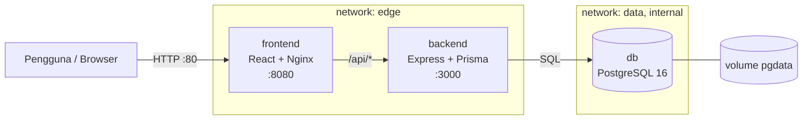

# KampusEvent


Aplikasi manajemen dan registrasi event kampus. Seluruh komponen dijalankan sebagai **container** dan dideploy otomatis melalui **GitHub Actions** setiap kali ada rilis.

> **Tugas UTS DevOps** — implementasi container (frontend, backend, database) + Continuous Integration & Continuous Deployment.

---

## Daftar isi

- [Fitur](#fitur)
- [Arsitektur](#arsitektur)
- [Akun demo](#akun-demo)
- [Menjalankan dengan Docker](#menjalankan-dengan-docker)
- [Pengembangan lokal](#pengembangan-lokal)
- [Environment variable](#environment-variable)
- [API](#api)
- [CI/CD](#cicd)
- [Akses publik & deployment](#akses-publik--deployment)
- [Testing](#testing)
- [Struktur repository](#struktur-repository)
- [Dokumentasi](#dokumentasi)
- [Troubleshooting](#troubleshooting)
- [Tim](#tim)

---

## Fitur

**Mahasiswa**
- Registrasi & login (JWT)
- Melihat, mencari, dan memfilter event kampus
- Mendaftar event dengan batas kuota otomatis
- Melihat dan membatalkan registrasi sendiri

**Admin**
- Dashboard statistik (event, mahasiswa, registrasi, kategori)
- CRUD event lengkap
- Melihat daftar peserta setiap event

**Teknis**
- 3 container terpisah: `frontend`, `backend`, `db`
- Healthcheck dan urutan start yang benar (`depends_on: condition: service_healthy`)
- Network terpisah: `edge` (publik) dan `data` (internal)
- Volume persisten untuk PostgreSQL
- Migrasi database otomatis saat container backend start
- Seed data idempotent
- Multi-stage build, image runtime non-root
- Image multi-arch (`linux/amd64`, `linux/arm64`)

---

## Arsitektur



- Browser hanya berkomunikasi dengan container **frontend**.
- Nginx menyajikan file statis React dan mem-proxy `/api` ke **backend**, sehingga tidak ada masalah CORS.
- **backend** satu-satunya service yang terhubung ke database.
- **db** berada di network `data` yang `internal: true`, sehingga tidak dapat diakses dari internet.

Detail lengkap: [`docs/ARSITEKTUR.md`](docs/ARSITEKTUR.md).

---

## Akun demo

| Peran | Email | Password |
|---|---|---|
| Admin | `admin@kampus.ac.id` | `Admin123!` |
| Mahasiswa | `budi@kampus.ac.id` | `Mahasiswa123!` |
| Mahasiswa | `sari@kampus.ac.id` | `Mahasiswa123!` |

Data contoh (4 event) dibuat otomatis saat pertama kali container backend berjalan (`SEED_ON_START=true`).

---

## Menjalankan dengan Docker

### Prasyarat

- Docker Desktop 4.x (Windows/macOS) **atau** Docker Engine + Compose v2 (Linux)
- Port `80` tersedia (atau ubah `APP_PORT`)

### Langkah

```bash
# 1. Siapkan konfigurasi
cp .env.example .env
#    Windows PowerShell: Copy-Item .env.example .env

# 2. Ganti password & JWT_SECRET di .env
#    (gunakan password alfanumerik agar URL database tetap valid)

# 3. Build & jalankan seluruh container
docker compose up -d --build

# 4. Cek status dan healthcheck
docker compose ps
```

Buka **http://localhost** (atau `http://localhost:8080` jika `APP_PORT=8080`).

Perintah berguna:

```bash
docker compose logs -f --tail=100     # melihat log semua container
docker compose ps                     # status + health
docker compose exec backend node prisma/seed.js   # seed ulang
docker compose down                   # hentikan container (data tetap)
docker compose down -v                # hentikan + hapus volume database
```

Contoh output `docker compose ps`:

```
NAME                  IMAGE                                              STATUS                    PORTS
kampusevent-backend   ghcr.io/<owner>/kampusevent-backend:latest         Up (healthy)              3000/tcp
kampusevent-db        postgres:16-alpine                                 Up (healthy)              5432/tcp
kampusevent-frontend  ghcr.io/<owner>/kampusevent-frontend:latest        Up (healthy)              0.0.0.0:80->8080/tcp
```

---

## Pengembangan lokal

Menjalankan tanpa container (butuh PostgreSQL lokal atau container database saja):

```bash
# Terminal 1 - database saja
docker compose up -d db

# Terminal 2 - backend
cd backend
cp .env.example .env        # sesuaikan DATABASE_URL ke localhost:5432
npm install
npx prisma migrate deploy
npm run seed
npm run dev                 # http://localhost:3000

# Terminal 3 - frontend
cd frontend
npm install
npm run dev                 # http://localhost:5173 (proxy /api -> :3000)
```

---

## Environment variable

Semua variabel dibaca dari file `.env` di root project. Lihat [`.env.example`](.env.example).

| Variabel | Wajib | Default | Keterangan |
|---|---|---|---|
| `POSTGRES_DB` | ya | – | Nama database |
| `POSTGRES_USER` | ya | – | User database |
| `POSTGRES_PASSWORD` | ya | – | Password database |
| `DATABASE_URL` | ya | – | Connection string yang dipakai backend |
| `JWT_SECRET` | ya | – | Minimal 16 karakter, gunakan string acak |
| `JWT_EXPIRES_IN` | tidak | `7d` | Masa berlaku token |
| `CORS_ORIGIN` | tidak | `*` | Origin yang diizinkan |
| `GHCR_OWNER` | ya | `local` | Username/organisasi GitHub (huruf kecil) |
| `IMAGE_TAG` | tidak | `latest` | Tag image yang dipakai |
| `APP_PORT` | tidak | `80` | Port host untuk frontend |
| `SEED_ON_START` | tidak | `true` | Isi data contoh saat start |
| `COMPOSE_PROFILES` | tidak | kosong | `tunnel`, `tunnel-static`, atau `tunnel-cf` |
| `NGROK_AUTHTOKEN` | tidak | – | Token ngrok untuk akses publik |
| `NGROK_URL` | tidak | – | Domain statis ngrok (profile `tunnel-static`) |

---

## API

Base URL: `http://localhost/api`

| Method | Endpoint | Akses | Keterangan |
|---|---|---|---|
| POST | `/auth/register` | publik | Daftar akun mahasiswa |
| POST | `/auth/login` | publik | Login, mengembalikan JWT |
| GET | `/auth/me` | login | Profil pengguna saat ini |
| GET | `/events` | publik | Daftar event (`?search=&category=`) |
| GET | `/events/:id` | publik | Detail event |
| POST | `/events` | admin | Buat event |
| PUT | `/events/:id` | admin | Ubah event |
| DELETE | `/events/:id` | admin | Hapus event |
| GET | `/events/:id/participants` | admin | Daftar peserta |
| POST | `/events/:id/registrations` | login | Daftar ke event |
| GET | `/me/registrations` | login | Registrasi milik sendiri |
| DELETE | `/registrations/:id` | login/admin | Batalkan registrasi |
| GET | `/stats` | admin | Statistik dashboard |
| GET | `/healthz` | publik | Liveness probe |
| GET | `/readyz` | publik | Readiness probe (cek database) |

Contoh:

```bash
curl -X POST http://localhost/api/auth/login \
  -H "Content-Type: application/json" \
  -d '{"email":"admin@kampus.ac.id","password":"Admin123!"}'
```

---

## CI/CD

| Workflow | Trigger | Isi |
|---|---|---|
| [`ci.yml`](.github/workflows/ci.yml) | PR & push `main` | Typecheck, unit + integration test (PostgreSQL service), validasi Compose, Hadolint, build & push image ke GHCR, Trivy scan |
| [`cd.yml`](.github/workflows/cd.yml) | Tag `v*.*.*` atau manual | Build image rilis (semver), deploy ke host via self-hosted runner, smoke test, rollback |

Alur rilis:

```bash
git tag v1.0.0
git push origin v1.0.0
```

GitHub Actions akan membangun image `v1.0.0` + `latest`, lalu menjalankan deploy di runner `kampusevent`.

Detail pipeline, secrets, dan cara rollback: [`docs/CI-CD.md`](docs/CI-CD.md).

---

## Akses publik & deployment

Deployment dijalankan pada host Docker (laptop/PC) melalui **self-hosted GitHub Actions runner**, lalu aplikasi diekspos ke internet dengan **tunnel** tanpa perlu membuka port router:

```bash
# Opsi 1 - ngrok dengan domain statis gratis (disarankan untuk laporan)
# isi NGROK_AUTHTOKEN, NGROK_URL, dan COMPOSE_PROFILES=tunnel-static di .env
docker compose up -d

# Opsi 2 - ngrok URL acak
# COMPOSE_PROFILES=tunnel
docker compose up -d

# Opsi 3 - Cloudflare Quick Tunnel (tanpa akun, URL berubah tiap restart)
# COMPOSE_PROFILES=tunnel-cf
docker compose up -d
docker compose logs cloudflared | Select-String trycloudflare
```

Panduan lengkap (instalasi Docker Desktop, runner, tunnel, rollback, troubleshooting): [`docs/DEPLOYMENT.md`](docs/DEPLOYMENT.md).

---

## Testing

```bash
# Backend (unit test selalu jalan, integration test butuh PostgreSQL)
cd backend
npm test
RUN_DB_TESTS=true DATABASE_URL=postgresql://... npm test

# Frontend
cd frontend
npm test
```

Di CI, integration test dijalankan otomatis menggunakan service container PostgreSQL 16.

---

## Struktur repository

```
.
├─ .github/workflows/       ci.yml, cd.yml
├─ backend/                 Express + Prisma + TypeScript
│  ├─ prisma/               schema, migrasi, seed
│  ├─ src/                  routes, middleware, lib
│  ├─ tests/
│  └─ Dockerfile
├─ frontend/                React + Vite + TypeScript
│  ├─ src/
│  ├─ nginx.conf
│  └─ Dockerfile
├─ docs/                    laporan, arsitektur, deployment, naskah video
├─ scripts/                 smoke test & backup database
├─ docker-compose.yml
├─ .env.example
└─ README.md
```

---

## Dokumentasi

| Dokumen | Isi |
|---|---|
| [`docs/LAPORAN.md`](docs/LAPORAN.md) | Laporan lengkap sesuai ketentuan tugas |
| [`docs/ARSITEKTUR.md`](docs/ARSITEKTUR.md) | Detail desain container, network, dan alur request |
| [`docs/CI-CD.md`](docs/CI-CD.md) | Penjelasan pipeline, secrets, rollback |
| [`docs/DEPLOYMENT.md`](docs/DEPLOYMENT.md) | Panduan instalasi & deployment dari nol |
| [`docs/VIDEO-SCRIPT.md`](docs/VIDEO-SCRIPT.md) | Naskah video 12 menit + checklist rekaman |

---

## Troubleshooting

| Gejala | Solusi |
|---|---|
| `port is already allocated` | Ubah `APP_PORT=8080` di `.env`, lalu `docker compose up -d` |
| Backend restart terus | `docker compose logs backend`; biasanya `DATABASE_URL`/password tidak cocok |
| `password authentication failed` | Hapus volume lama: `docker compose down -v`, lalu up ulang |
| Halaman putih setelah deploy | Pastikan image frontend terbaru: `docker compose pull frontend` |
| `unauthorized` setelah login | `JWT_SECRET` berubah → logout lalu login ulang |
| Runner offline | Jalankan `run.cmd` di folder runner (Docker Desktop harus aktif) |

---

## Tim

| No | Nama | NIM | Peran |
|---|---|---|---|
| 1 | _isi nama_ | _isi NIM_ | Ketua / DevOps Lead |
| 2 | _isi nama_ | _isi NIM_ | Backend Developer |
| 3 | _isi nama_ | _isi NIM_ | Frontend Developer |
| 4 | _isi nama_ | _isi NIM_ | Database & Security |
| 5 | _isi nama_ | _isi NIM_ | Dokumentasi & Media |

---

Dibangun untuk memenuhi tugas UTS mata kuliah DevOps. Stack: React 18, Vite, Express 4, Prisma 6, PostgreSQL 16, Nginx, Docker Compose, GitHub Actions.
