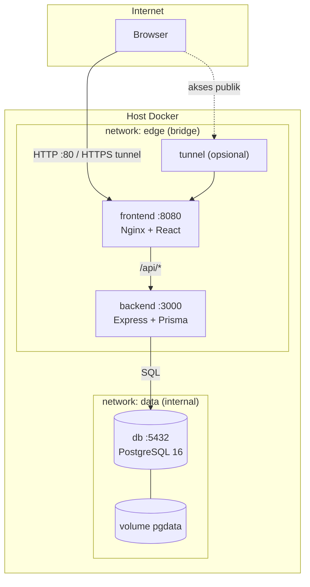
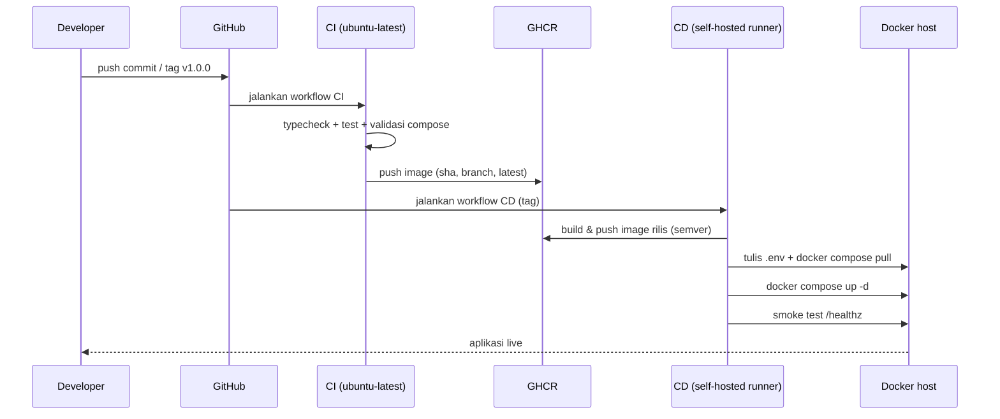

# Arsitektur KampusEvent

Dokumen ini menjelaskan desain teknis aplikasi dan alasan di balik setiap keputusan.

---

## 1. Gambaran umum

KampusEvent terdiri dari tiga container wajib dan dua container opsional untuk akses publik.

| Container | Image | Peran | Port |
|---|---|---|---|
| `frontend` | `ghcr.io/<owner>/kampusevent-frontend` | Menyajikan React hasil build + reverse proxy `/api` | `8080` (dipetakan ke `${APP_PORT}`) |
| `backend` | `ghcr.io/<owner>/kampusevent-backend` | REST API Express + Prisma | `3000` (internal) |
| `db` | `postgres:16-alpine` | Penyimpanan data | `5432` (internal) |
| `ngrok` / `ngrok-static` / `cloudflared` | image resmi | Tunnel publik (opsional) | – |



---

## 2. Alur request

### 2.1 Membuka halaman

1. Browser meminta `/` ke container `frontend`.
2. Nginx mengembalikan `index.html` dan aset React.
3. React Router menangani navigasi di sisi klien (SPA fallback `try_files $uri $uri/ /index.html`).

### 2.2 Memanggil API

1. React memanggil `/api/events` ke origin yang sama.
2. Nginx mencocokkan `location /api/` lalu meneruskan ke `http://backend:3000` (nama service diselesaikan oleh DNS internal Docker).
3. Backend memproses, mengakses PostgreSQL melalui Prisma, dan mengembalikan JSON.

Karena FE dan BE berada di origin yang sama, **CORS tidak diperlukan** pada deployment. Konfigurasi `CORS_ORIGIN` tetap disediakan untuk pengembangan lokal (`localhost:5173`).

### 2.3 Login & otorisasi

1. `POST /api/auth/login` memverifikasi password dengan bcrypt.
2. Backend menandatangani JWT (`sub`, `email`, `role`) dengan `JWT_SECRET`.
3. Frontend menyimpan token dan mengirim header `Authorization: Bearer <token>`.
4. Middleware `requireAuth` memverifikasi token; `requireRole('ADMIN')` membatasi endpoint admin.

---

## 3. Isolasi jaringan

```yaml
networks:
  edge:
    driver: bridge
  data:
    driver: bridge
    internal: true
```

| Service | `edge` | `data` | Alasan |
|---|---|---|---|
| `frontend` | ✅ | ❌ | Hanya perlu berbicara dengan backend |
| `backend` | ✅ | ✅ | Menerima request dari FE dan mengakses DB |
| `db` | ❌ | ✅ | Tidak boleh diakses dari internet |

Karena `data` bersifat `internal`, container database tidak memiliki jalur keluar ke internet. Ini mengurangi risiko exfiltration dan serangan langsung ke port 5432.

---

## 4. Healthcheck & urutan start

Urutan boot: **db → backend → frontend**.

| Service | Healthcheck | Efek |
|---|---|---|
| `db` | `pg_isready -U ... -d ...` | Backend menunggu database benar-benar siap menerima koneksi |
| `backend` | `node -e "fetch('/healthz')"` | Frontend menunggu API hidup sebelum Nginx dijalankan |
| `frontend` | `wget /healthz` | Status `healthy` terlihat di `docker compose ps` |

`depends_on` dengan `condition: service_healthy` mencegah error "connection refused" saat migrasi database dijalankan.

Endpoint:
- `GET /healthz` — liveness, tidak menyentuh database.
- `GET /readyz` — readiness, menjalankan `SELECT 1` ke PostgreSQL.

---

## 5. Persistensi data

- Volume bernama `kampusevent-pgdata` dipasang di `/var/lib/postgresql/data`.
- `docker compose down` **tidak** menghapus data.
- `docker compose down -v` menghapus volume (dipakai saat reset total).
- Backup manual: `scripts/backup-db.ps1` (menjalankan `pg_dump` di dalam container).

Data bertahan ketika container dibuat ulang saat deploy, karena image baru hanya mengganti container, bukan volume.

---

## 6. Strategi image

### Backend (`backend/Dockerfile`)

| Stage | Isi |
|---|---|
| `deps` | `npm ci` seluruh dependency |
| `build` | `prisma generate` + kompilasi TypeScript ke `dist/` |
| `runtime` | `npm ci --omit=dev`, generate Prisma Client, salin `dist/`, jalankan sebagai user `node` |

Runtime memakai `node:20-bookworm-slim` karena Prisma membutuhkan OpenSSL. Entrypoint menjalankan `prisma migrate deploy` sebelum aplikasi start.

### Frontend (`frontend/Dockerfile`)

| Stage | Isi |
|---|---|
| `build` | `npm ci` + `vite build` |
| `runtime` | `nginxinc/nginx-unprivileged:1.27-alpine` |

Image Nginx *unprivileged* berjalan sebagai user non-root (UID 101) dan mendengarkan port 8080, bukan 80. Ini memenuhi praktik keamanan container tanpa perlu menambahkan capability.

### Tag image

| Tag | Kapan dibuat | Kegunaan |
|---|---|---|
| `latest` | setiap push `main` dan rilis | default compose |
| `main` | push ke branch `main` | tracking branch |
| `<sha pendek>` | setiap build | audit & rollback presisi |
| `v1.2.3`, `1.2` | saat tag rilis | rilis versi |

Image dibangun multi-arch (`linux/amd64`, `linux/arm64`) agar dapat berjalan di laptop Intel/AMD maupun server ARM.

---

## 7. Keamanan

Sudah diterapkan:

- Container backend & frontend berjalan sebagai non-root.
- Database tidak terekspos ke host/internet.
- Secret hanya berasal dari `.env` lokal atau GitHub Secrets; `.env` di-ignore Git.
- `helmet` mengatur header keamanan HTTP; Nginx menambahkan `X-Content-Type-Options`, `X-Frame-Options`, dan `Referrer-Policy`.
- Password di-hash dengan bcrypt (10 rounds).
- Validasi input dengan Zod di setiap endpoint.
- Image dipindai Trivy (HIGH/CRITICAL) di CI.
- SBOM dan provenance dihasilkan oleh Buildx.
- Self-hosted runner **hanya** dipakai untuk job deploy (tag/manual), bukan untuk job dari pull request — mencegah eksekusi kode tidak tepercaya di host.

Keterbatasan yang diakui (cocok untuk skala tugas, dapat ditingkatkan):

- JWT disimpan di `localStorage` (rentan XSS); alternatif produksi: cookie `HttpOnly` + CSRF token.
- Pengecekan kapasitas event belum memakai transaksi `SERIALIZABLE`, sehingga dua pendaftaran bersamaan pada kursi terakhir berpotensi lolos. Solusi: transaksi + `SELECT ... FOR UPDATE` atau constraint tambahan.
- Belum ada rate limiting pada endpoint login.
- Belum ada HTTPS di dalam container; TLS diterminasi oleh tunnel (ngrok/Cloudflare) atau reverse proxy di depan.

---

## 8. Alur deployment



---

## 9. Keputusan desain & alternatif

| Keputusan | Alternatif | Alasan dipilih |
|---|---|---|
| Nginx mem-proxy `/api` | Frontend memanggil API dengan URL absolut + CORS | Satu origin, tidak ada preflight, konfigurasi lebih sederhana |
| Prisma `migrate deploy` saat start | Job migrasi terpisah | Tiga container tetap mandiri; cocok untuk skala tugas |
| Compose | Kubernetes | Overhead operasional jauh lebih besar untuk 3 service |
| Self-hosted runner + tunnel | VPS cloud | Tanpa biaya dan tanpa verifikasi kartu; pipeline tetap identik dengan target VPS |
| Satu file `docker-compose.yml` | Compose terpisah dev/prod | Mengurangi duplikasi; perbedaan hanya pada perintah `build` vs `pull` |
