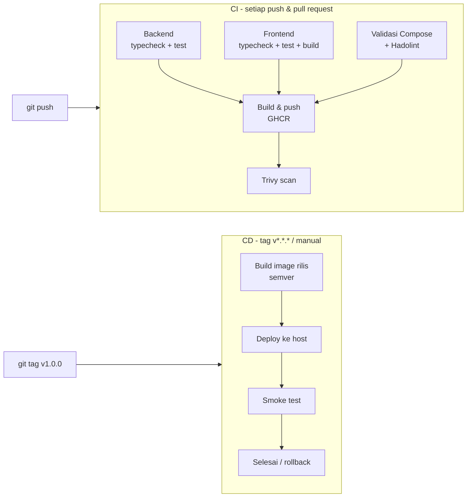

# Implementasi CI/CD

Pipeline menggunakan **GitHub Actions** dengan dua workflow terpisah:

- `ci.yml` — Continuous Integration
- `cd.yml` — Continuous Deployment

---

## 1. Ringkasan



| Workflow | File | Trigger |
|---|---|---|
| CI | `.github/workflows/ci.yml` | `push` ke `main`, `pull_request` ke `main`, manual |
| CD | `.github/workflows/cd.yml` | tag `v*.*.*`, manual (`image_tag`) |

---

## 2. CI (`ci.yml`)

### Job `backend-test`

1. Menyiapkan **service container PostgreSQL 16** dengan healthcheck.
2. `npm ci`, `prisma generate`, `prisma migrate deploy`.
3. `tsc --noEmit` (typecheck).
4. `npm test` dengan `RUN_DB_TESTS=true`:
   - unit test health & validasi (selalu jalan),
   - integration test alur admin/mahasiswa terhadap database sungguhan.

### Job `frontend-test`

1. `npm ci`.
2. `tsc --noEmit`.
3. `vitest run` (unit test util + komponen).
4. `vite build` untuk memastikan bundle produksi valid.

### Job `docker-validate`

1. Menyalin `.env.example` menjadi `.env` (agar interpolasi Compose valid).
2. `docker compose config -q` — memvalidasi sintaks dan referensi service/volume/network.
3. **Hadolint** untuk `backend/Dockerfile` dan `frontend/Dockerfile` dengan ambang `error`.

### Job `build-push` (hanya push ke `main`)

1. Setup QEMU + Buildx.
2. Login ke GHCR menggunakan `GITHUB_TOKEN`.
3. Metadata image:
   - `sha` pendek,
   - nama branch,
   - `latest`.
4. Build multi-arch `linux/amd64,linux/arm64`, cache `type=gha`.
5. Push ke `ghcr.io/<owner>/kampusevent-{backend,frontend}`.
6. Menghasilkan **SBOM** dan **provenance**.

### Job `security-scan`

Menjalankan Trivy pada image yang baru dipublikasikan (`severity HIGH,CRITICAL`, `ignore-unfixed`). Hasil bersifat laporan (`continue-on-error`) agar build tidak gagal karena CVE pada base image, tetapi tetap terlihat di log.

---

## 3. CD (`cd.yml`)

### Job `build-release`

Berjalan saat push tag `v*.*.*`. Membangun image dengan tag:

- `v1.0.0` (versi penuh),
- `1.0` (major.minor),
- `sha` pendek,
- `latest`.

### Job `deploy`

Berjalan di **self-hosted runner** dengan label `kampusevent` (host Docker yang sama dengan tempat aplikasi berjalan).

Langkah:

1. Checkout repository.
2. **Menulis `.env`** dari GitHub Secrets & Variables (file tidak pernah masuk Git).
3. Login ke GHCR dengan `GITHUB_TOKEN`.
4. `docker compose pull` — mengambil image yang baru dibangun.
5. `docker compose up -d --remove-orphans` — membuat ulang container yang berubah tanpa menghentikan database (volume tetap).
6. `docker compose ps` — menampilkan status.
7. **Smoke test** `GET /healthz` hingga 30 percobaan × 3 detik. Jika gagal, log 100 baris terakhir dicetak dan job digagalkan.
8. `docker image prune -f` — membersihkan image lama.

Pengaman tambahan:

- `environment: production` (dapat diaktifkan *required reviewers* untuk approval manual).
- `concurrency: production-deploy` — deploy tidak berjalan bersamaan.
- Rollback = menjalankan workflow manual dengan `image_tag` versi sebelumnya.

---

## 4. Secrets & variables

Atur di **Settings → Secrets and variables → Actions**.

### Secrets

| Nama | Wajib | Isi |
|---|---|---|
| `POSTGRES_PASSWORD` | ✅ | Password database produksi (alfanumerik) |
| `JWT_SECRET` | ✅ | String acak minimal 32 karakter |
| `NGROK_AUTHTOKEN` | opsional | Token ngrok bila memakai tunnel |

> `GITHUB_TOKEN` tersedia otomatis dan dipakai untuk login GHCR.

### Variables

| Nama | Default | Isi |
|---|---|---|
| `APP_PORT` | `80` | Port host aplikasi |
| `COMPOSE_PROFILES` | kosong | `tunnel-static`, `tunnel`, atau `tunnel-cf` |
| `NGROK_URL` | – | Domain statis ngrok (mis. `https://kampusevent.ngrok-free.app`) |
| `POSTGRES_DB` | `kampusevent` | Nama database |
| `POSTGRES_USER` | `kampusevent` | User database |

---

## 5. Alur rilis & rollback

### Rilis baru

```bash
git checkout main
git pull
git tag v1.0.0
git push origin v1.0.0
```

Hasil:
1. `build-release` membangun image `v1.0.0`.
2. `deploy` menarik dan menjalankan versi tersebut.
3. Smoke test memastikan aplikasi sehat.

### Rollback

1. Buka **Actions → CD → Run workflow**.
2. Isi `image_tag` dengan versi sebelumnya, misalnya `v0.9.0` atau `<sha>`.
3. Jalankan.

Compose akan menarik image tersebut dan membuat ulang container backend/frontend. Database tidak berubah.

### Verifikasi setelah deploy

```bash
docker compose ps
docker compose logs --tail=50 backend
curl http://localhost/healthz
```

---

## 6. Self-hosted runner

Dibutuhkan karena deploy dilakukan ke host Docker lokal (tanpa VPS). Langkah instalasi lengkap ada di [`DEPLOYMENT.md`](DEPLOYMENT.md#6-menyiapkan-self-hosted-runner).

Ringkas:

1. GitHub → **Settings → Actions → Runners → New self-hosted runner** (Windows x64).
2. Jalankan `config.cmd` dengan label `kampusevent`.
3. Jalankan `run.cmd` **secara interaktif** agar dapat mengakses Docker Desktop.
4. Pastikan runner berstatus **Idle** di GitHub.

Catatan keamanan: runner hanya menerima job CD dari tag/manual pada repository sendiri. Job CI (termasuk dari pull request) tetap berjalan di `ubuntu-latest` milik GitHub, sehingga kode dari fork tidak dieksekusi di host.

---

## 7. Skenario demonstrasi untuk video

1. Tunjukkan repository dan file `.github/workflows/ci.yml`.
2. Ubah kecil (mis. teks di halaman), commit, push ke `main`.
3. Buka tab **Actions** → tunjukkan job test berjalan dan hijau.
4. Tunjukkan tab **Packages** → image baru dengan tag `sha` dan `latest`.
5. Buat tag `v1.0.0` dan push.
6. Tunjukkan workflow **CD** berjalan: build rilis → deploy di runner → smoke test.
7. Buka aplikasi dari URL tunnel → tunjukkan perubahan sudah live.
8. Demonstrasi rollback dengan `image_tag` versi sebelumnya.
