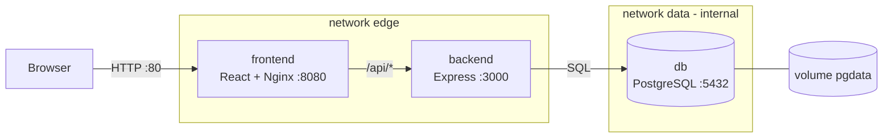
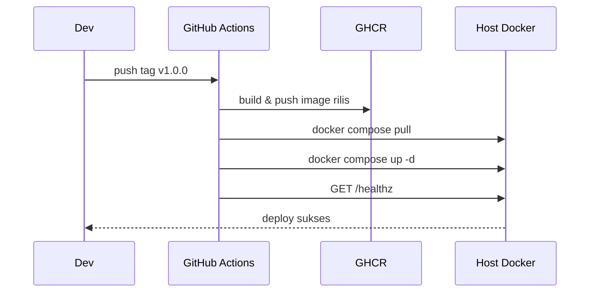

# LAPORAN TUGAS UTS DEVOPS

## Implementasi Deployment Aplikasi Berbasis Container dengan CI/CD

<br/>

**Nama Aplikasi: KampusEvent**

**Platform Manajemen dan Registrasi Event Kampus**

<br/>

Disusun oleh:

| No | Nama Anggota | NIM | Peran |
|---|---|---|---|
| 1 | _Nama Anggota 1_ | _NIM_ | Ketua / DevOps Lead |
| 2 | _Nama Anggota 2_ | _NIM_ | Backend Developer |
| 3 | _Nama Anggota 3_ | _NIM_ | Frontend Developer |
| 4 | _Nama Anggota 4_ | _NIM_ | Database & Security |
| 5 | _Nama Anggota 5_ | _NIM_ | Dokumentasi & Media |

**Mata Kuliah:** DevOps
**Program Studi:** _isi program studi_
**Tahun:** 2026

---

## Ringkasan Eksekutif

KampusEvent adalah aplikasi web untuk mengelola event kampus dan pendaftaran peserta. Aplikasi dibangun dengan React (frontend), Express + Prisma (backend), dan PostgreSQL (database), lalu dijalankan sebagai **tiga container terpisah** menggunakan Docker Compose.

Proses rilis sepenuhnya otomatis melalui **GitHub Actions**:

- **CI** berjalan pada setiap push dan pull request: typecheck, unit test, integration test dengan PostgreSQL, validasi Docker Compose, lint Dockerfile, build image multi-arch, push ke GHCR, dan pemindaian kerentanan.
- **CD** berjalan saat tag rilis dibuat: membangun image versi, men-deploy ke host Docker melalui self-hosted runner, dan memverifikasi aplikasi dengan smoke test.

Aplikasi diakses publik melalui tunnel (ngrok/Cloudflare), sehingga tidak memerlukan VPS maupun pembukaan port router. Seluruh biaya implementasi **Rp 0**.

---

## Daftar Isi

1. [Pendahuluan](#1-pendahuluan)
2. [Deskripsi Aplikasi dan Cara Penggunaan](#2-deskripsi-aplikasi-dan-cara-penggunaan)
3. [Detail Aplikasi](#3-detail-aplikasi)
4. [File Pendukung dan Aplikasi Tambahan](#4-file-pendukung-dan-aplikasi-tambahan)
5. [Implementasi Container](#5-implementasi-container)
6. [Implementasi CI/CD](#6-implementasi-cicd)
7. [Pengujian](#7-pengujian)
8. [Video Implementasi](#8-video-implementasi)
9. [Kendala dan Solusi](#9-kendala-dan-solusi)
10. [Kesimpulan](#10-kesimpulan)
11. [Lampiran](#11-lampiran)
12. [Referensi](#12-referensi)

---

## 1. Pendahuluan

### 1.1 Latar Belakang

Pengembangan aplikasi tidak berhenti pada kode yang berjalan di komputer pengembang. Aplikasi harus dapat dikirim ke pengguna dengan cepat, konsisten, dan dapat diulang. Perbedaan konfigurasi antar komputer sering menyebabkan masalah "berjalan di laptop saya, tetapi gagal di server".

Container menyelesaikan masalah tersebut dengan mengemas aplikasi beserta dependensinya ke dalam image yang identik di mana pun dijalankan. Untuk mempercepat dan mengurangi kesalahan saat rilis, proses build, pengujian, dan deployment perlu diotomatisasi melalui Continuous Integration (CI) dan Continuous Deployment (CD).

### 1.2 Rumusan Masalah

1. Bagaimana mengemas aplikasi frontend, backend, dan database ke dalam container terpisah?
2. Bagaimana menghubungkan ketiga container secara aman dan menjaga data tetap persisten?
3. Bagaimana membangun pipeline CI/CD yang menguji, membangun image, dan men-deploy aplikasi secara otomatis?

### 1.3 Tujuan

1. Menyediakan aplikasi yang berjalan penuh di atas container (minimal 3 container: FE, BE, DB).
2. Menerapkan CI/CD menggunakan GitHub Actions dan GitHub Container Registry.
3. Menyediakan akses publik bagi pengguna tanpa biaya infrastruktur.

### 1.4 Batasan

- Deployment dijalankan pada host Docker lokal melalui self-hosted runner, dengan akses publik melalui tunnel.
- Skala pengguna terbatas (lingkungan demonstrasi), bukan lingkungan produksi berkapasitas tinggi.
- Autentikasi menggunakan JWT; belum menerapkan refresh token atau cookie HttpOnly.

---

## 2. Deskripsi Aplikasi dan Cara Penggunaan

### 2.1 Deskripsi

KampusEvent membantu civitas kampus menyelenggarakan event secara terpusat. Admin dapat membuat event, memantau kuota, dan melihat peserta. Mahasiswa dapat mencari event, mendaftar, dan membatalkan pendaftaran. Sistem menolak pendaftaran ganda dan pendaftaran saat kuota penuh.

### 2.2 Fitur

| Peran | Fitur |
|---|---|
| Publik | Melihat daftar event, mencari, memfilter kategori, melihat detail |
| Mahasiswa | Registrasi akun, login, mendaftar event, melihat dan membatalkan registrasi |
| Admin | Login, dashboard statistik, membuat/mengubah/menghapus event, melihat daftar peserta |

### 2.3 Akun Demo

| Peran | Email | Password |
|---|---|---|
| Admin | `admin@kampus.ac.id` | `Admin123!` |
| Mahasiswa | `budi@kampus.ac.id` | `Mahasiswa123!` |
| Mahasiswa | `sari@kampus.ac.id` | `Mahasiswa123!` |

### 2.4 Cara Penggunaan

**A. Menjalankan aplikasi (Docker)**

```bash
cp .env.example .env      # sesuaikan password & JWT_SECRET
docker compose up -d --build
```

Buka `http://localhost` (atau port sesuai `APP_PORT`).

**B. Alur mahasiswa**

1. Buka halaman utama → daftar event tampil.
2. Klik **Daftar** → isi nama, email, password → akun dibuat dan langsung login.
3. Gunakan pencarian atau filter kategori.
4. Klik salah satu event → **Daftar sekarang**.
5. Buka **Registrasi Saya** untuk melihat atau membatalkan pendaftaran.

**C. Alur admin**

1. Login dengan akun admin → diarahkan ke **Dashboard**.
2. Lihat ringkasan statistik: total event, event mendatang, mahasiswa, dan registrasi.
3. Klik **+ Buat Event** → isi judul, deskripsi, kategori, kapasitas, lokasi, dan jadwal → simpan.
4. Gunakan tombol **Edit** atau **Hapus** pada tabel event.
5. Klik **Peserta** untuk melihat daftar mahasiswa yang mendaftar.

### 2.5 Tampilan Aplikasi

> Ganti berkas gambar di `docs/img/` dan sesuaikan nama file bila perlu.

| Halaman | Gambar |
|---|---|
| Beranda / daftar event | `` |
| Login | `` |
| Detail event | `` |
| Registrasi saya | `` |
| Dashboard admin | `` |
| Form event | `` |
| Daftar peserta | `` |

---

## 3. Detail Aplikasi

### 3.1 Stack Teknologi

| Lapisan | Teknologi | Versi |
|---|---|---|
| Frontend | React + TypeScript + Vite | React 18, Vite 6 |
| Web server / reverse proxy | Nginx (unprivileged) | 1.27 |
| Backend | Node.js + Express + TypeScript | Node 20, Express 4 |
| ORM / migrasi | Prisma | 6 |
| Database | PostgreSQL | 16 |
| Container | Docker + Docker Compose | Compose v2 |
| CI/CD | GitHub Actions + GHCR | – |
| Tunnel publik | ngrok / Cloudflare Tunnel | – |

### 3.2 Arsitektur



Penjelasan:

- Browser hanya terhubung ke container **frontend**.
- Nginx menyajikan aset React dan mem-proxy `/api` ke **backend** → satu origin, tidak ada CORS.
- **backend** satu-satunya yang terhubung ke **db**.
- Network `data` bersifat `internal`, sehingga database tidak dapat diakses dari luar.
- Volume `kampusevent-pgdata` menjaga data tetap ada saat container diperbarui.

Detail lengkap ada di [`ARSITEKTUR.md`](ARSITEKTUR.md).

### 3.3 Struktur Repository

```
.
├─ .github/workflows/    ci.yml, cd.yml
├─ backend/              Express + Prisma + TypeScript + Dockerfile
├─ frontend/             React + Vite + Nginx + Dockerfile
├─ docs/                 laporan, arsitektur, CI/CD, deployment, naskah video
├─ scripts/              smoke test & backup database
├─ docker-compose.yml    3 container wajib + tunnel opsional
├─ .env.example
└─ README.md
```

### 3.4 Skema Database

```
User            Event                  Registration
├─ id           ├─ id                  ├─ id
├─ name         ├─ title               ├─ eventId  (FK)
├─ email        ├─ description         ├─ userId   (FK)
├─ passwordHash ├─ category            ├─ status
├─ role         ├─ location            └─ createdAt
└─ createdAt    ├─ startsAt               UNIQUE(eventId, userId)
                ├─ capacity
                ├─ createdById (FK)
                └─ timestamps
```

Migrasi SQL disimpan di `backend/prisma/migrations/` dan dijalankan otomatis (`prisma migrate deploy`) saat container backend start.

### 3.5 Sumber Kode dan Referensi

Aplikasi **dibangun dari nol** oleh kelompok (bukan fork/clone template), menggunakan dokumentasi resmi berikut:

- React — <https://react.dev/>
- Vite — <https://vite.dev/guide/>
- React Router — <https://reactrouter.com/>
- Express — <https://expressjs.com/>
- Prisma — <https://www.prisma.io/docs>
- PostgreSQL — <https://www.postgresql.org/docs/16/>
- Nginx — <https://nginx.org/en/docs/>
- Docker — <https://docs.docker.com/>
- Docker Compose — <https://docs.docker.com/compose/>
- GitHub Actions — <https://docs.github.com/actions>
- GitHub Container Registry — <https://docs.github.com/packages>
- Trivy — <https://aquasecurity.github.io/trivy/>
- Hadolint — <https://github.com/hadolint/hadolint>
- ngrok — <https://ngrok.com/docs>
- Cloudflare Tunnel — <https://developers.cloudflare.com/cloudflare-one/connections/connect-networks/>

---

## 4. File Pendukung dan Aplikasi Tambahan

| Nama | Jenis | Fungsi dalam proyek |
|---|---|---|
| Docker Desktop / Docker Engine | Aplikasi | Menjalankan container |
| Docker Compose | Tool | Orkestrasi 3 container, network, volume |
| WSL2 | Komponen OS | Backend Docker Desktop di Windows |
| Nginx | Image container | Menyajikan frontend + reverse proxy |
| PostgreSQL 16 Alpine | Image container | Database |
| Prisma CLI | Library/tool | Migrasi dan seed database |
| GitHub Actions | Layanan CI/CD | Menjalankan pipeline |
| GitHub Container Registry (GHCR) | Registry | Menyimpan image hasil build |
| Hadolint | Tool CI | Lint Dockerfile |
| Trivy | Tool CI | Pemindaian kerentanan image |
| Docker Buildx + QEMU | Tool CI | Build multi-arch (amd64/arm64) |
| ngrok / Cloudflare Tunnel | Layanan | Akses publik tanpa port forwarding |
| Git & GitHub | Tool | Version control dan kolaborasi |
| VS Code | Editor | Pengembangan |

### 4.1 File Konfigurasi Penting

| File | Fungsi |
|---|---|
| `docker-compose.yml` | Definisi service, network, volume, healthcheck |
| `.env.example` | Template environment (tanpa secret asli) |
| `backend/Dockerfile` | Multi-stage build backend |
| `frontend/Dockerfile` | Build React + runtime Nginx |
| `frontend/nginx.conf` | Proxy `/api`, SPA fallback, cache, header keamanan |
| `backend/docker-entrypoint.sh` | Migrasi database sebelum aplikasi start |
| `backend/prisma/schema.prisma` | Skema database |
| `backend/prisma/seed.js` | Data demo idempotent |
| `.github/workflows/ci.yml` | Pipeline integrasi |
| `.github/workflows/cd.yml` | Pipeline deployment |
| `scripts/smoke-test.ps1` | Pemeriksaan kesehatan aplikasi |
| `scripts/backup-db.ps1` | Backup database |

---

## 5. Implementasi Container

### 5.1 Ringkasan Container

| Container | Image | Port host | Network | Volume |
|---|---|---|---|---|
| `frontend` | `ghcr.io/<owner>/kampusevent-frontend` | `${APP_PORT}:8080` | `edge` | – |
| `backend` | `ghcr.io/<owner>/kampusevent-backend` | – (internal) | `edge`, `data` | – |
| `db` | `postgres:16-alpine` | – (internal) | `data` | `pgdata` |
| `tunnel` (opsional) | `ngrok/ngrok` atau `cloudflare/cloudflared` | – | `edge` | – |

### 5.2 Dockerfile Backend (ringkas)

```dockerfile
FROM node:20-bookworm-slim AS deps
COPY package*.json ./
RUN npm ci

FROM deps AS build
COPY prisma ./prisma
RUN npx prisma generate
COPY src ./src
RUN npm run build

FROM node:20-bookworm-slim AS runtime
RUN apt-get install -y openssl ca-certificates
COPY package*.json ./
RUN npm ci --omit=dev
COPY prisma ./prisma
RUN npx prisma generate
COPY --from=build /app/dist ./dist
RUN chown -R node:node /app
USER node
ENTRYPOINT ["./docker-entrypoint.sh"]
```

Poin penting:

- Multi-stage mengecilkan image runtime.
- `USER node` menjalankan aplikasi sebagai non-root.
- Migrasi database otomatis pada entrypoint.
- Healthcheck memanfaatkan `fetch` bawaan Node 20.

### 5.3 Dockerfile Frontend (ringkas)

```dockerfile
FROM node:20-alpine AS build
COPY package*.json ./
RUN npm ci
COPY . .
RUN npm run build

FROM nginxinc/nginx-unprivileged:1.27-alpine
COPY nginx.conf /etc/nginx/conf.d/default.conf
COPY --from=build /app/dist /usr/share/nginx/html
EXPOSE 8080
```

Poin penting:

- Aset statis hasil build Vite disajikan Nginx.
- Image `unprivileged` berjalan sebagai non-root pada port 8080.
- `nginx.conf` mem-proxy `/api` ke `backend:3000`.

### 5.4 Orkestrasi (ringkas)

```yaml
services:
  db:
    image: postgres:16-alpine
    volumes: [pgdata:/var/lib/postgresql/data]
    networks: [data]
    healthcheck:
      test: ["CMD-SHELL", "pg_isready -U $$POSTGRES_USER -d $$POSTGRES_DB"]

  backend:
    image: ghcr.io/${GHCR_OWNER}/kampusevent-backend:${IMAGE_TAG}
    build: ./backend
    depends_on:
      db: { condition: service_healthy }
    networks: [data, edge]

  frontend:
    image: ghcr.io/${GHCR_OWNER}/kampusevent-frontend:${IMAGE_TAG}
    build: ./frontend
    ports: ["${APP_PORT}:8080"]
    depends_on:
      backend: { condition: service_healthy }
    networks: [edge]

networks:
  edge: { driver: bridge }
  data: { driver: bridge, internal: true }

volumes:
  pgdata:
```

### 5.5 Bukti Container Berjalan

Tempel screenshot `docker compose ps` di sini:

> ``

Contoh keluaran:

```
kampusevent-backend   Up (healthy)   3000/tcp
kampusevent-db        Up (healthy)   5432/tcp
kampusevent-frontend  Up (healthy)   0.0.0.0:80->8080/tcp
```

Perintah pembuktian lain:

```bash
docker compose config          # validasi konfigurasi
docker network ls              # network kampusevent_edge, kampusevent_data
docker volume ls               # volume kampusevent-pgdata
docker inspect --format '{{.HostConfig.PortBindings}}' kampusevent-backend   # kosong = tidak terekspos
```

### 5.6 Persistensi

```bash
docker compose down            # container dihapus
docker compose up -d           # data tetap ada
docker compose exec db psql -U kampusevent -d kampusevent -c "SELECT count(*) FROM \"Event\";"
```

---

## 6. Implementasi CI/CD

### 6.1 Continuous Integration

File: `.github/workflows/ci.yml`

| Job | Isi |
|---|---|
| `backend-test` | `npm ci`, `prisma generate`, `migrate deploy`, typecheck, unit & integration test dengan service container PostgreSQL |
| `frontend-test` | typecheck, unit test (Vitest + Testing Library), build Vite |
| `docker-validate` | `docker compose config -q`, Hadolint pada kedua Dockerfile |
| `build-push` | Buildx multi-arch, push image ke GHCR dengan tag `sha`, `main`, `latest`; SBOM & provenance |
| `security-scan` | Trivy (HIGH/CRITICAL, `ignore-unfixed`) |

Trigger: push ke `main`, pull request ke `main`, manual.

### 6.2 Continuous Deployment

File: `.github/workflows/cd.yml`

| Job | Isi |
|---|---|
| `build-release` | Saat tag `v*.*.*`: build & push image dengan tag `v1.0.0`, `1.0`, `sha`, `latest` |
| `deploy` | Self-hosted runner: tulis `.env` dari secrets → login GHCR → `compose pull` → `compose up -d` → smoke test → prune |

Pengaman:

- `environment: production`
- `concurrency: production-deploy`
- Smoke test 30×3 detik; gagal → log dicetak & job gagal
- Rollback melalui `workflow_dispatch` dengan input `image_tag`

### 6.3 Alur Rilis

```bash
git tag v1.0.0
git push origin v1.0.0
```



### 6.4 Secrets dan Variables

| Nama | Jenis | Fungsi |
|---|---|---|
| `POSTGRES_PASSWORD` | secret | Password database |
| `JWT_SECRET` | secret | Kunci tanda tangan JWT |
| `NGROK_AUTHTOKEN` | secret (opsional) | Token tunnel |
| `APP_PORT` | variable | Port host |
| `COMPOSE_PROFILES` | variable | Mengaktifkan tunnel |
| `NGROK_URL` | variable | Domain statis |
| `POSTGRES_DB` / `POSTGRES_USER` | variable | Kredensial database |

`GITHUB_TOKEN` dipakai otomatis untuk login GHCR.

### 6.5 Bukti Pipeline

> ``
> ``
> ``
> ``

---

## 7. Pengujian

### 7.1 Pengujian Otomatis

| Jenis | Lokasi | Cakupan | Dijalankan di |
|---|---|---|---|
| Unit test backend | `backend/tests/health.test.ts`, `auth-validation.test.ts` | Health endpoint, 404, validasi register/login | Setiap CI |
| Integration test backend | `backend/tests/api-integration.test.ts` | Register, login, RBAC, CRUD event, pendaftaran, duplikasi | CI (PostgreSQL service) |
| Unit test frontend | `frontend/src/utils/format.test.ts` | Format tanggal, kursi, inisial | Setiap CI |
| Component test frontend | `frontend/src/components/EventCard.test.tsx` | Render kartu event & status penuh | Setiap CI |
| Validasi Docker | CI | `compose config`, Hadolint | Setiap CI |
| Security scan | CI | Trivy | Push `main` |
| Smoke test deploy | CD | `GET /healthz` | Setiap deploy |

### 7.2 Hasil Pengujian

| Skenario | Hasil yang diharapkan | Status |
|---|---|---|
| Register email duplikat | HTTP 409 | ✅ |
| Login password salah | HTTP 401 | ✅ |
| Mahasiswa membuat event | HTTP 403 | ✅ |
| Daftar event dua kali | HTTP 409 | ✅ |
| Kapasitas penuh | HTTP 409 | ✅ |
| Healthcheck ketiga container | `healthy` | ✅ |
| Data bertahan setelah `compose down` + `up` | Data tetap | ✅ |
| Deploy tag baru | Aplikasi terbarui | ✅ |
| Rollback ke tag lama | Versi lama aktif | ✅ |

> Sesuaikan status dengan hasil sebenarnya setelah menjalankan pengujian, dan lampirkan screenshot.

### 7.3 Perintah Pengujian Manual

```bash
cd backend && npm test
cd frontend && npm test
docker compose ps
curl http://localhost/healthz
curl http://localhost/api/events
```

---

## 8. Video Implementasi

**Link video:** `[isi tautan YouTube unlisted / Google Drive]`

Durasi: **_isi durasi_** (wajib 5–15 menit)

Ringkasan isi video:

| Waktu | Materi |
|---|---|
| 00:00 | Perkenalan kelompok dan aplikasi |
| 00:50 | Demo aplikasi (mahasiswa & admin) |
| 02:30 | Arsitektur 3 container, network, volume |
| 04:00 | Penjelasan Dockerfile dan Compose |
| 06:00 | Menjalankan container dan healthcheck |
| 07:15 | Demonstrasi CI di GitHub Actions |
| 09:15 | Demonstrasi CD, aplikasi live, rollback |
| 11:15 | Kendala, pembelajaran, penutup |

---

## 9. Kendala dan Solusi

| Kendala | Solusi |
|---|---|
| Docker Desktop belum terpasang | Instalasi WSL2 + Docker Desktop; diverifikasi dengan `hello-world` |
| Port 80 dipakai aplikasi lain | Menambahkan `APP_PORT` pada `.env` (mis. 8080) |
| Backend gagal connect saat start | Healthcheck PostgreSQL + `depends_on: service_healthy` |
| Data hilang saat deploy | Menggunakan named volume `pgdata` |
| Frontend dan backend beda origin (CORS) | Nginx mem-proxy `/api` sehingga satu origin |
| Self-hosted runner tidak dapat mengakses Docker | Runner dijalankan interaktif pada sesi user yang sama dengan Docker Desktop |
| URL tunnel berubah setiap restart | Menggunakan domain statis gratis ngrok |
| Image besar | Multi-stage build + `npm ci --omit=dev` |
| Kerentanan base image | Trivy scan dan pembaruan image dasar berkala |

---

## 10. Kesimpulan

1. Aplikasi berhasil dijalankan sebagai **tiga container terpisah** (frontend, backend, database) dengan network, volume, dan healthcheck yang benar.
2. **CI** memastikan setiap perubahan melewati typecheck, pengujian otomatis, validasi konfigurasi container, dan pemindaian kerentanan sebelum image dipublikasikan.
3. **CD** memungkinkan rilis satu perintah (`git push` tag) dengan verifikasi otomatis dan jalur rollback yang jelas.
4. Akses publik dapat diberikan tanpa biaya infrastruktur melalui tunnel, sehingga aplikasi dapat langsung digunakan pengguna.

Saran pengembangan: menambahkan HTTPS dengan domain sendiri, rate limiting pada login, transaksi database untuk pendaftaran bersamaan, serta monitoring terpusat (mis. Prometheus + Grafana).

---

## 11. Lampiran

### A. Perintah Utama

```bash
# Menjalankan
docker compose up -d --build
docker compose ps
docker compose logs -f --tail=100

# Rilis
git tag v1.0.0 && git push origin v1.0.0

# Rollback (manual)
IMAGE_TAG=v0.9.0 docker compose pull
IMAGE_TAG=v0.9.0 docker compose up -d

# Reset total
docker compose down -v
```

### B. Checklist Screenshot

| No | File | Isi |
|---|---|---|
| 1 | `01-beranda.png` | Halaman daftar event |
| 2 | `02-login.png` | Halaman login |
| 3 | `03-detail-event.png` | Detail event + tombol daftar |
| 4 | `04-registrasi-saya.png` | Daftar registrasi mahasiswa |
| 5 | `05-dashboard-admin.png` | Statistik admin |
| 6 | `06-form-event.png` | Form buat/edit event |
| 7 | `07-peserta.png` | Daftar peserta |
| 8 | `08-docker-ps.png` | Tiga container healthy |
| 9 | `09-ci-hijau.png` | Workflow CI sukses |
| 10 | `10-build-push.png` | Build & push image |
| 11 | `11-cd-deploy.png` | Workflow CD sukses |
| 12 | `12-ghcr-packages.png` | Image di GHCR |
| 13 | `13-tunnel.png` | Aplikasi diakses via URL publik |
| 14 | `14-rollback.png` | Rollback berhasil |

### C. Penilaian Mandiri terhadap Rubrik

| Komponen | Bobot | Bukti | Status |
|---|---|---|---|
| Penggunaan container minimal 3 (FE, BE, DB) | 50 | `docker-compose.yml`, 3 Dockerfile/image, network, volume, healthcheck | ✅ |
| Implementasi CI/CD | 20 | `ci.yml`, `cd.yml`, GHCR, smoke test, rollback | ✅ |
| Video penjelasan 5–15 menit | 20 | Link video | ⬜ |
| Kelengkapan laporan | 10 | Dokumen ini + README + dokumentasi pendukung | ✅ |

---

## 12. Referensi

1. React Documentation. <https://react.dev/>
2. Vite Documentation. <https://vite.dev/guide/>
3. Express Documentation. <https://expressjs.com/>
4. Prisma Documentation. <https://www.prisma.io/docs>
5. PostgreSQL 16 Documentation. <https://www.postgresql.org/docs/16/>
6. Nginx Documentation. <https://nginx.org/en/docs/>
7. Docker Documentation. <https://docs.docker.com/>
8. Docker Compose Documentation. <https://docs.docker.com/compose/>
9. GitHub Actions Documentation. <https://docs.github.com/actions>
10. GitHub Container Registry. <https://docs.github.com/packages/working-with-a-github-packages-registry/working-with-the-container-registry>
11. Aqua Security Trivy. <https://aquasecurity.github.io/trivy/>
12. Hadolint. <https://github.com/hadolint/hadolint>
13. ngrok Documentation. <https://ngrok.com/docs>
14. Cloudflare Tunnel. <https://developers.cloudflare.com/cloudflare-one/connections/connect-networks/>
